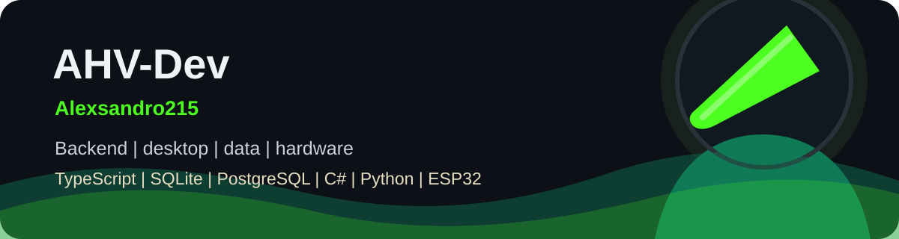
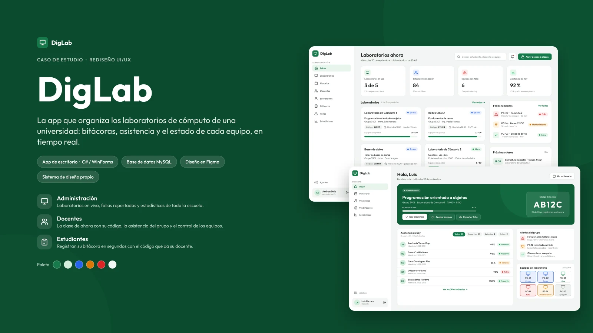
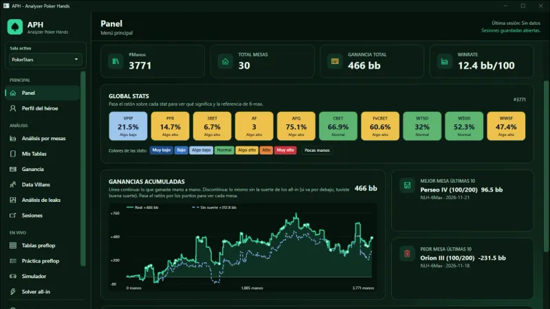
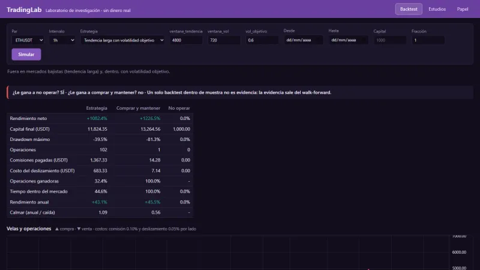
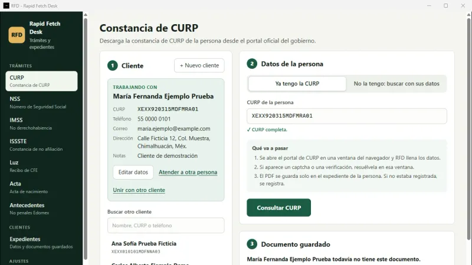
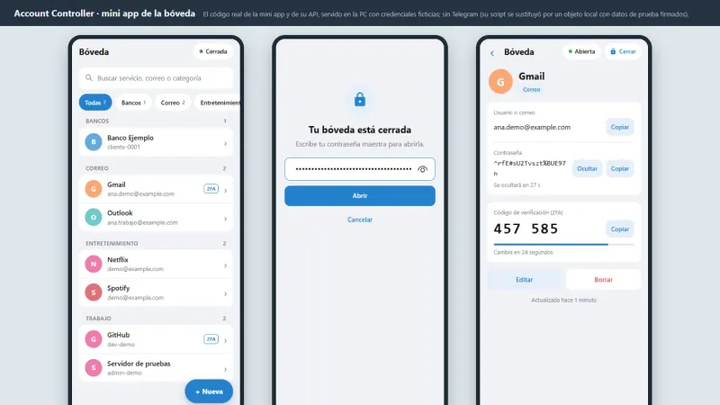
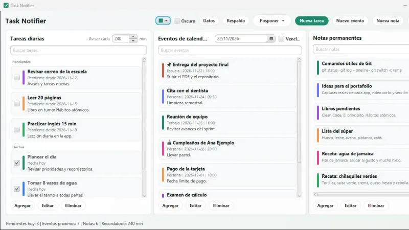
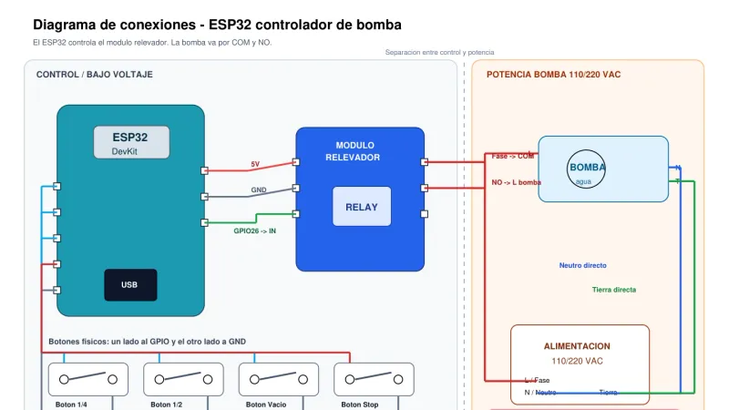
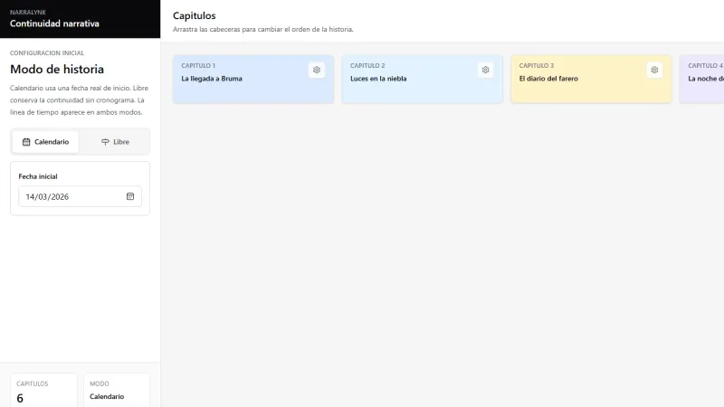

Soy **Alexsandro Hernández Vargas (AHV-Dev)**, desarrollador de software y de bases de datos. Hago programas que se usan todos los días: sistemas de escritorio, bases de datos, herramientas de análisis y modelos predictivos, automatizaciones, bots y firmware para ESP32. Me gusta resolver el problema completo, desde el modelo de datos y la seguridad hasta la pantalla que usa la persona, y también la diseño: el rediseño de DigLab lo hice en Figma.

**Abierto a trabajo** como desarrollador Jr., administrador de bases de datos (DBA) o soporte de sistemas.

> Entender el pasado, para comprender el presente y construir el futuro.

## En corto

- **Sistema institucional en uso:** DigLab registra el uso de los laboratorios de cómputo del TESCHI, con cuatro roles, modo kiosco, modo sin conexión e instalador propio.
- **Bases de datos:** MySQL con migraciones versionadas y cuentas con el mínimo privilegio; PostgreSQL con Prisma; SQLite con EF Core, SQLx y Microsoft.Data.Sqlite; Parquet para análisis de datos.
- **Diseño UI/UX:** rediseño completo de DigLab en Figma, con sistema de diseño propio (variables de color, componentes con variantes y 20 íconos).
- **Modelos predictivos:** Elo, regresión logística, LightGBM y redes neuronales en PyTorch entrenadas en GPU, evaluados sin ver el futuro.
- **Teoría de juegos:** solver push/fold con CFR+ y una biblioteca GTO de 40,365 flops resueltos.
- **Escritorio:** C#/.NET (WPF y WinForms), Java/JavaFX y Tauri (Rust + Svelte).
- **Backend y automatización:** TypeScript, Node.js, Express, FastAPI y Playwright.
- **Seguridad aplicada:** PBKDF2, scrypt y X25519 + AES-256-GCM.
- **Calidad:** pruebas automatizadas (443 en APH, 115 en Account Controller y 96 en TradingLab).
- **Hardware:** ESP32 en C++ con red WiFi propia, servidor web, relevadores y botones físicos.
- **Ofimática:** paquetería Microsoft Office: Word, Excel, PowerPoint, Outlook, Access, OneNote y Teams.

## Caso de estudio: rediseño de DigLab

DigLab es el sistema que lleva las bitácoras de los laboratorios de cómputo. Lo rediseñé desde cero en Figma para que cada rol vea primero lo que necesita:

- **Administración:** los laboratorios en vivo, las fallas reportadas y las estadísticas de toda la escuela.
- **Docentes:** la clase de ahora con su código, la asistencia del grupo y el estado de cada equipo.
- **Estudiantes:** registran su bitácora en segundos con el código que les da su docente.

El archivo incluye 4 pantallas, un sistema de diseño con 30 variables de color, 8 componentes con variantes y 20 íconos. Los nombres y datos son de ejemplo.

**[Ver el diseño en Figma →](https://www.figma.com/design/bxuhltnX8oO6J6i97vIIv3)**

## Proyectos destacados

Cada proyecto público tiene capturas reales del programa funcionando (con datos de demostración) en su carpeta `docs/evidencia/`.

<table>
  <tr>
    <td width="50%" valign="top">
       
      <a href="https://www.figma.com/design/bxuhltnX8oO6J6i97vIIv3"><strong>DigLab</strong></a> · código privado (institucional) · diseño en Figma 
      Bitácoras de los laboratorios de cómputo del TESCHI: horarios por laboratorio, cuatro roles, modo kiosco, modo sin conexión e instalador propio. 
      C# · WinForms · MySQL · PowerShell · Figma
    </td>
    <td width="50%" valign="top">
       
      <strong>APH · Analyzer Poker Hands</strong> · código privado 
      Analítica de historiales de póker para Windows: dashboards, perfiles de rivales, reportes PDF y solvers de teoría de juegos (CFR+ y GTO postflop). 
      C# · .NET 8 · WPF · SQLite · 443 pruebas
    </td>
  </tr>
  <tr>
    <td width="50%" valign="top">
       
      <strong>LoLPred</strong> · código privado 
      Probabilidad de victoria en partidos profesionales de esports con Elo, regresión logística, LightGBM y redes neuronales: 66.5 % de acierto en 53,793 partidas, evaluado sin ver el futuro. 
      Python · PyTorch · LightGBM · scikit-learn · pandas
    </td>
    <td width="50%" valign="top">
       
      <a href="https://github.com/Alexsandro215/ALL-PUBLISHER"><strong>All Publisher</strong></a> 
      Publica una vez en YouTube, TikTok, Instagram y Facebook: valida cada red, muestra la vista previa en el móvil, programa la publicación y reintenta solo la red que falló. 
      TypeScript · React · Express · Playwright
    </td>
  </tr>
  <tr>
    <td width="50%" valign="top">
       
      <a href="https://github.com/Alexsandro215/RTA"><strong>RTA · Real Time Analysis</strong></a> 
      Análisis de mercado cripto: datos OHLCV, indicadores, 12 estrategias, walk-forward y operación en papel en un panel web. 
      Python · FastAPI · ccxt · Plotly
    </td>
    <td width="50%" valign="top">
       
      <a href="https://github.com/Alexsandro215/TradingLab"><strong>TradingLab</strong></a> 
      Laboratorio de estrategias sin dinero real: backtests con costos reales, walk-forward y comparación obligatoria contra no operar y contra comprar y mantener. 
      Python · pandas · SQLite · FastAPI · 96 pruebas
    </td>
  </tr>
  <tr>
    <td width="50%" valign="top">
       
      <a href="https://github.com/Alexsandro215/RFD"><strong>RFD · Rapid Fetch Desk</strong></a> 
      Expedientes de clientes: captura los datos una vez, automatiza siete trámites web y guarda cada PDF en su expediente, listo para imprimir. 
      Tauri 2 · Svelte 5 · Rust · SQLx
    </td>
    <td width="50%" valign="top">
       
      <a href="https://github.com/Alexsandro215/Account-Controller"><strong>Account Controller</strong></a> 
      Bóveda personal de contraseñas en Telegram: bot y mini app con cifrado protegido por una contraseña maestra. 
      TypeScript · Node.js · Prisma · PostgreSQL · 115 pruebas
    </td>
  </tr>
  <tr>
    <td width="50%" valign="top">
       
      <a href="https://github.com/Alexsandro215/TaskNotifierApp"><strong>Task Notifier App</strong></a> 
      Tareas diarias, eventos y notas desde la bandeja de Windows, con recordatorios anticipados y modo oscuro. 
      Java · JavaFX · Gradle
    </td>
    <td width="50%" valign="top">
       
      <a href="https://github.com/Alexsandro215/esp32-water-doser"><strong>ESP32 Water Doser</strong></a> 
      Firmware que llena un tinaco: crea su propia red WiFi con una página para configurar tiempos y controla la bomba con relevador y botones físicos. 
      C++ · ESP32 · PlatformIO · Arduino
    </td>
  </tr>
  <tr>
    <td width="50%" valign="top">
       
      <strong>MiAval</strong> · código privado 
      Control de préstamos personales: calendario de pagos automático, semáforo por persona y totales del mes. 
      C# · .NET 10 · WPF · EF Core · SQLite
    </td>
    <td width="50%" valign="top">
       
      <a href="https://github.com/Alexsandro215/Narralynk"><strong>Narralynk</strong></a> · prototipo 
      Tablero visual para escribir historias por capítulos y escenas, con arrastrar y soltar. 
      React 19 · Zustand · dnd-kit
    </td>
  </tr>
</table>

## Habilidades

**Lenguajes** 

**Bases de datos** 

**Backend** 

**Escritorio** 

**Web y frontend** 

**Datos e inteligencia artificial** 

**Automatización y hardware** 

**Diseño y herramientas** 

**Ofimática (Microsoft Office)** 

## Cómo trabajo

1. **Entender el problema:** hablo con quien lo va a usar y escribo qué debe pasar antes de escribir código.
2. **Diseñar la pantalla:** primero en Figma, con componentes reutilizables, para validar la idea antes de programarla.
3. **Modelar la información:** esquemas versionados por migraciones y datos que sobreviven a errores, cortes de red y apagones.
4. **Construir por fases:** entregas pequeñas, cada una probada antes de pasar a la siguiente.
5. **Medir:** pruebas automatizadas, comparación contra referencias (por ejemplo, contra «no operar») y una bitácora de decisiones.

## Lenguajes

## Estadísticas

## Contacto

