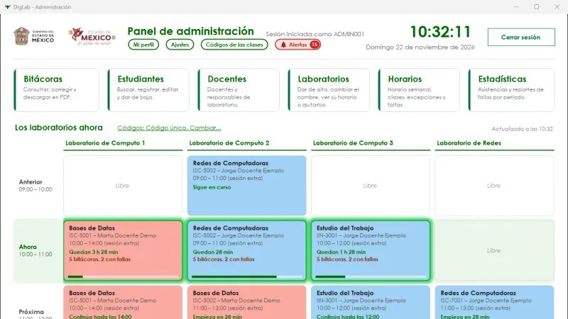
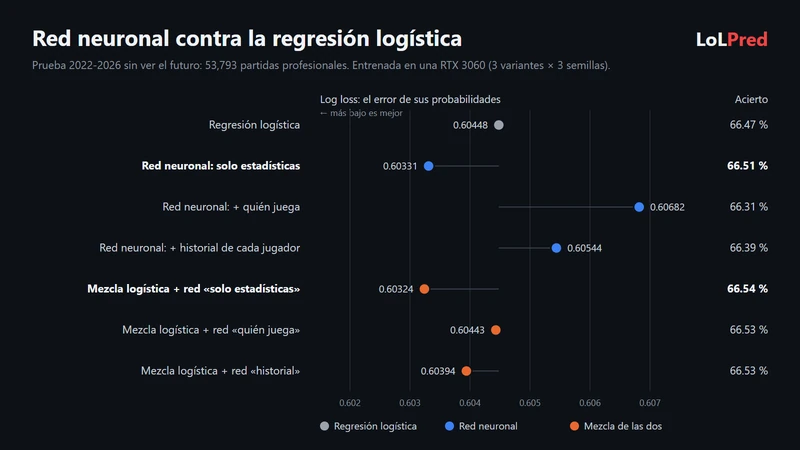
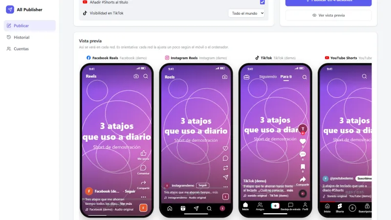
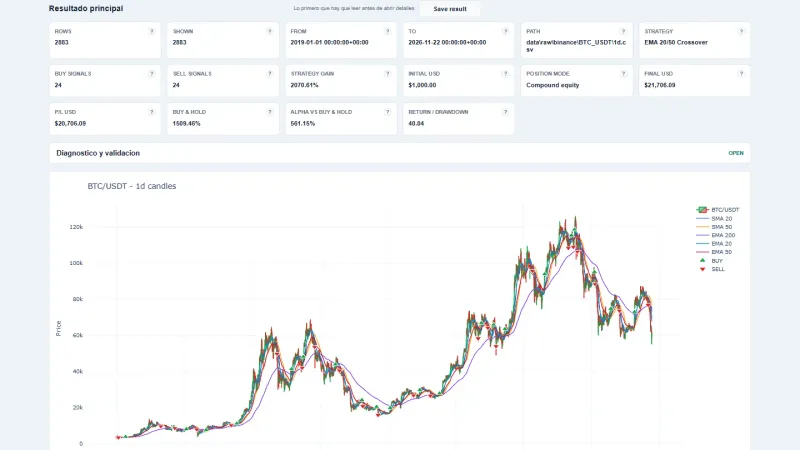
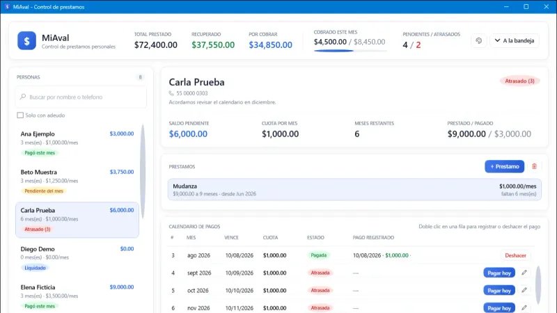
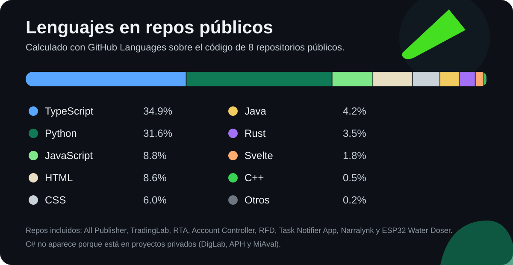

Soy **Alexsandro Hernández Vargas (AHV-Dev)**, Ingeniero en Sistemas Computacionales. Construyo software que se usa todos los días: apps de escritorio, herramientas de datos y modelos predictivos, automatizaciones, bots y firmware para ESP32. Me gusta resolver el problema completo, desde la base de datos y la seguridad hasta la pantalla que usa la persona.

> Entender el pasado, para comprender el presente y construir el futuro.

## En corto

- **Sistema institucional en uso:** DigLab registra el uso de los laboratorios de cómputo del TESCHI (roles, modo kiosco, modo sin conexión, instalador propio).
- **Modelos predictivos:** Elo, regresión logística, LightGBM y redes neuronales en PyTorch entrenadas en GPU, evaluados sin ver el futuro.
- **Teoría de juegos:** solver push/fold con CFR+ y una biblioteca GTO de 40,365 flops resueltos.
- **Escritorio:** C#/.NET (WPF y WinForms), Java/JavaFX y Tauri (Rust + Svelte).
- **Backend y automatización:** TypeScript, Node.js, Prisma, PostgreSQL, FastAPI y Playwright.
- **Seguridad aplicada:** PBKDF2, scrypt, X25519 + AES-256-GCM, cuentas de base de datos con el mínimo privilegio.
- **Persistencia:** PostgreSQL con Prisma, MySQL con migraciones versionadas, SQLite (EF Core, SQLx y Microsoft.Data.Sqlite), Parquet y localStorage.
- **Hardware:** ESP32 en C++ con red WiFi propia, servidor web, relevadores y botones físicos.

## Proyectos destacados

Cada proyecto tiene capturas reales del programa funcionando (con datos de demostración) en su carpeta `docs/evidencia/`.

<table>
  <tr>
    <td width="50%" valign="top">
       
      <strong>DigLab</strong> · código privado (institucional) 
      Bitácoras de los laboratorios de cómputo del TESCHI: horarios por laboratorio, cuatro roles, modo kiosco y modo sin conexión. 
      C# · WinForms · MySQL · PowerShell
    </td>
    <td width="50%" valign="top">
       
      <a href="https://github.com/Alexsandro215/APH"><strong>APH · Analyzer Poker Hands</strong></a> 
      Analítica de historiales de póker con dashboards, perfiles de rivales, reportes PDF y solvers de teoría de juegos. 
      C# · .NET 8 · WPF · SQLite · 443 pruebas
    </td>
  </tr>
  <tr>
    <td width="50%" valign="top">
       
      <strong>LoLPred</strong> · código privado 
      Probabilidad de victoria en partidos profesionales de esports. Redes neuronales entrenadas en una RTX 3060: 66.5 % de acierto en 53,793 partidas. 
      Python · PyTorch · LightGBM · scikit-learn
    </td>
    <td width="50%" valign="top">
       
      <a href="https://github.com/Alexsandro215/ALL-PUBLISHER"><strong>All Publisher</strong></a> 
      Publica una vez en YouTube, TikTok, Instagram y Facebook: valida cada red, vista previa en el móvil y reintenta solo la red que falló. 
      TypeScript · React · Express · Playwright
    </td>
  </tr>
  <tr>
    <td width="50%" valign="top">
       
      <a href="https://github.com/Alexsandro215/RTA"><strong>RTA · Real Time Analysis</strong></a> 
      Análisis de mercado cripto: indicadores, 12 estrategias, walk-forward y operación en papel en un panel web. 
      Python · FastAPI · ccxt · Plotly
    </td>
    <td width="50%" valign="top">
       
      <a href="https://github.com/Alexsandro215/TradingLab"><strong>TradingLab</strong></a> 
      Laboratorio de estrategias sin dinero real: backtests con costos reales, walk-forward y comparación obligatoria contra no operar. 
      Python · pandas · SQLite · 96 pruebas
    </td>
  </tr>
  <tr>
    <td width="50%" valign="top">
       
      <a href="https://github.com/Alexsandro215/RFD"><strong>RFD · Rapid Fetch Desk</strong></a> 
      Expedientes de clientes y siete trámites web automatizados; cada PDF queda en el expediente, listo para imprimir. 
      Tauri 2 · Svelte 5 · Rust · SQLx
    </td>
    <td width="50%" valign="top">
       
      <a href="https://github.com/Alexsandro215/Account-Controller"><strong>Account Controller</strong></a> 
      Bóveda de contraseñas en Telegram con bot y mini app, cifrada con una contraseña maestra. 
      TypeScript · Node.js · Prisma · PostgreSQL · 115 pruebas
    </td>
  </tr>
  <tr>
    <td width="50%" valign="top">
       
      <a href="https://github.com/Alexsandro215/TaskNotifierApp"><strong>Task Notifier App</strong></a> 
      Tareas, eventos y notas desde la bandeja de Windows, con avisos anticipados y modo oscuro. 
      Java · JavaFX · Gradle
    </td>
    <td width="50%" valign="top">
       
      <a href="https://github.com/Alexsandro215/esp32-water-doser"><strong>ESP32 Water Doser</strong></a> 
      Firmware que llena un tinaco: red WiFi propia con página de configuración, relevador y botones físicos. 
      C++ · ESP32 · PlatformIO · Arduino
    </td>
  </tr>
  <tr>
    <td width="50%" valign="top">
       
      <strong>MiAval</strong> · código privado 
      Control de préstamos personales: calendario de pagos automático, semáforo por persona y totales del mes. 
      C# · .NET 10 · WPF · EF Core · SQLite
    </td>
    <td width="50%" valign="top">
       
      <a href="https://github.com/Alexsandro215/Narralynk"><strong>Narralynk</strong></a> · prototipo 
      Tablero visual para escribir historias por capítulos y escenas, con arrastrar y soltar. 
      React 19 · Zustand · dnd-kit
    </td>
  </tr>
</table>

## Stack técnico

## Cómo trabajo

1. **Entender el problema:** hablo con quien lo va a usar y escribo qué debe pasar antes de escribir código.
2. **Modelar la información:** esquemas versionados por migraciones y datos que sobreviven a errores, cortes de red y apagones.
3. **Construir por fases:** entregas pequeñas, cada una probada antes de pasar a la siguiente.
4. **Medir:** pruebas automatizadas, comparación contra referencias (por ejemplo, contra "no operar" o contra el mercado) y una bitácora de decisiones.

## Lenguajes

## Estadísticas

## Contacto

